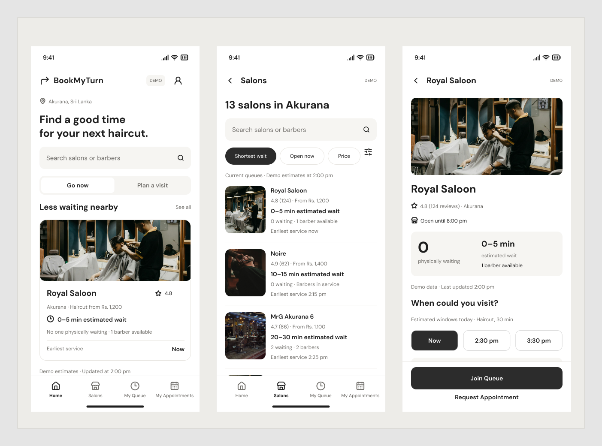

# Customer design review

[Open the Figma design](https://www.figma.com/design/wugLxCXK2CM44607SvxZwF?node-id=9-140).
[Review PR #2](https://github.com/nadhirhasan/BookMyTurn/pull/2) is a draft against
`main`; planning PR #1 has merged.

The first review replaces the earlier dark/blue shell with a light, neutral
customer experience informed by official Fresha, Booksy and Treatwell references.
The focus is comparing salon waits and deciding when to visit.

## Created in Figma

- Home: location, search, Go now / Plan a visit, and a photo-led salon card.
- Salon comparison: physical waiting count, estimated wait, earliest service,
  starting price and rating. The Noire example has no physical queue but busy
  barbers, so it still shows a future estimated service time.
- Royal Saloon: current queue and freshness, estimated visit windows, and separate
  Join Queue and Request Appointment actions. Longer content scrolls in the
  design viewport; it is not all visible in the static screenshot.
- Reusable salon cards, navigation variants, form fields, barber choices, status
  labels and time choices; neutral library buttons/search; 26 local foundation
  variables and 8 DM Sans text styles. Icons remain editable vector paths.

All salon names, prices, ratings and availability are fictional demonstration
content. Stock photography does not depict the named Akurana salons or staff.

## Validation and limits

The discovery board contains 335 editable descendants, including 91 text nodes,
112 vector nodes, 18 instances and discrete photography layers. It is not a
flattened full-screen image. An icon wrapper-fill defect in the initial render
was fixed, and the corrected composition above was visually inspected.

The Figma MCP stopped further edits with a Starter-plan tool-call-limit error
before the queue screens were created. The account reports a Starter plan with a
View seat. See [Figma's current allowance documentation](https://developers.figma.com/docs/figma-mcp-server/rate-limits-access/).

Queue/check-in, appointment states, optional account screens and prototype links
are still pending. This is an editable-screen review, **not a completed clickable
prototype**. Prepared source scripts for pending screens are not evidence that
those screens exist in Figma.

User verification and merge remain pending. React Native UI development stays
paused until the design gate is satisfied; the rejected local shell is preserved
outside this review PR.

## Sources and resuming

- [Design direction and reference sources](../docs/DESIGN_DIRECTION.md)
- [Milestone and review checklist](../docs/IMPLEMENTATION_PLAN.md)
- [Actual Figma node/style/component manifest](figma/manifest.json)
- [Figma construction source and execution status](figma/README.md)

Photography is used under the Unsplash License:

- [Kawê Rodrigues: salon haircut](https://unsplash.com/photos/a-man-cutting-another-mans-hair-in-a-salon-JsiH9gv73n0)
- [Barney Goodman: barbershop interior](https://unsplash.com/photos/an-empty-barbershop-interior-with-several-chairs-and-mirrors-AXurvQTtO3Y)
- [Allef Vinicius: beard service](https://unsplash.com/photos/man-sitting-on-barbers-chair-IvQeAVeJULw)

Icons are from `lucide-static` 1.64.0; [the ISC licence](figma/LUCIDE-LICENSE.txt)
is included. Stock photos are the only raster content inside the screens.
