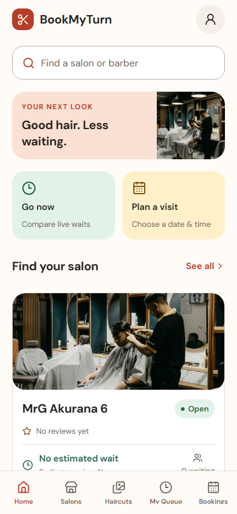
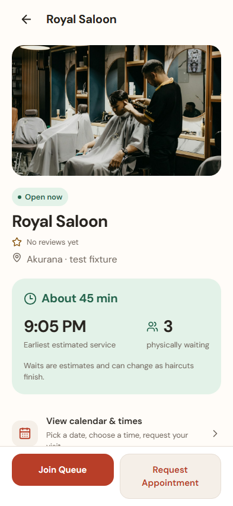
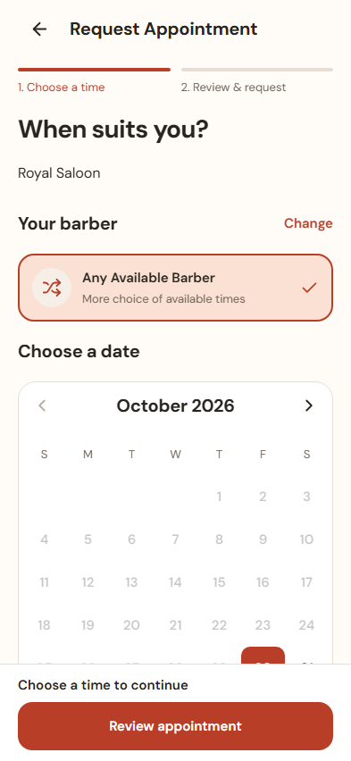
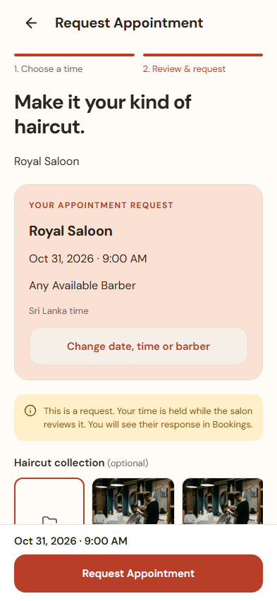
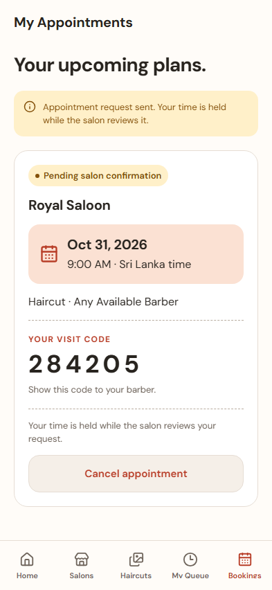
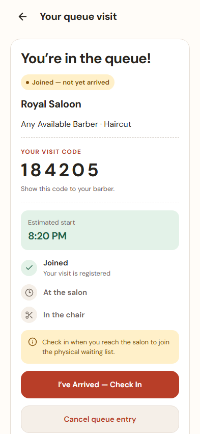
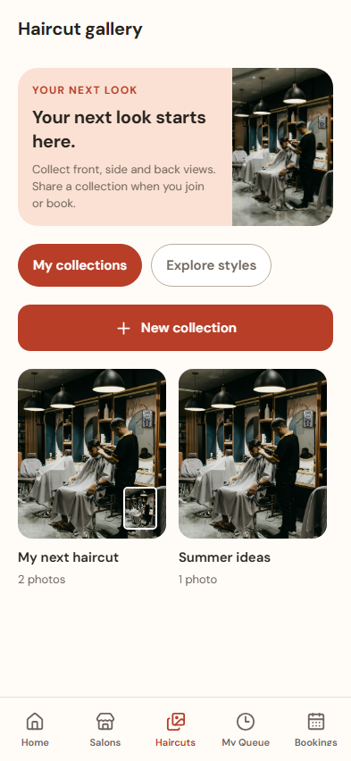
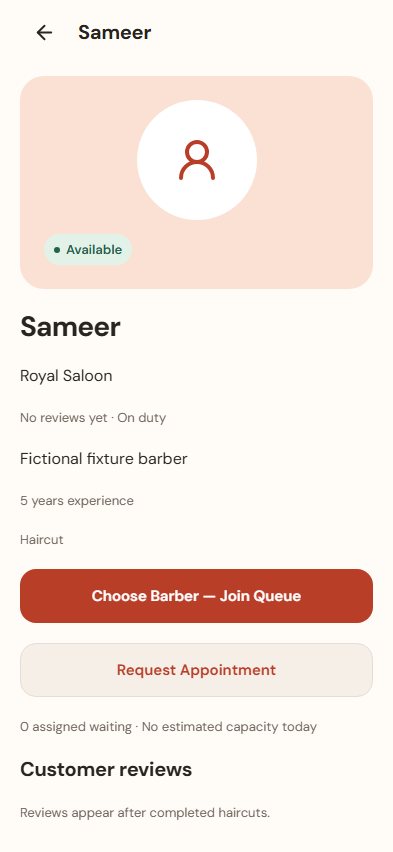
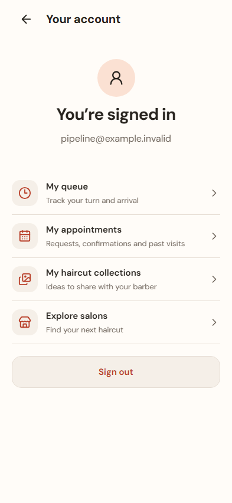

# Customer redesign review

Rendered from the actual Expo web app at 393 × 852, 2 November 2026.
The code serves the same screens on iPhone and Android; native device acceptance
is still required. These are browser renders, not Figma frames.

All names, availability, codes, account details and collections in these images
are isolated test fixtures. Photos are the project's existing licensed stock
assets and do not depict those fictional salons or customers. No fixture records
were inserted into Supabase.

See [research, rationale and validation](../../../docs/CUSTOMER_UX_REDESIGN.md).

| Discovery | Salon | Calendar |
| --- | --- | --- |
|  |  |  |

| Review request | Booking status | Queue receipt |
| --- | --- | --- |
|  |  |  |

| Collections | Barber profile | Account |
| --- | --- | --- |
|  |  |  |

[Queue joining screen](join.png). Longer screens scroll; screenshots show a
viewport, not every action in the flow.

On your phone, test discovery, a specific/any barber, a calendar request,
returning through sign-in, an unavailable time, remote queue check-in, account-free
QR arrival, collection sharing and full-size photo preview. Repeat with larger
system text and the keyboard open. Owner/Barber visual redesign is the next pass.
