# Manager and Barber screen review

Rendered from the Expo web app at 393 × 852, 2 November 2026. These are working
app screens, not Figma frames. Native phone acceptance remains pending.

Names, visits, money, account details and images in these screenshots are local
test fixtures. Photography is existing licensed project stock; it does not depict
the fictional businesses or customers. No screenshot fixture was added to Supabase.

See [decisions and validation](../../../docs/STAFF_UX_REDESIGN.md).

| Locations | Salon queue | Agenda |
| --- | --- | --- |
| 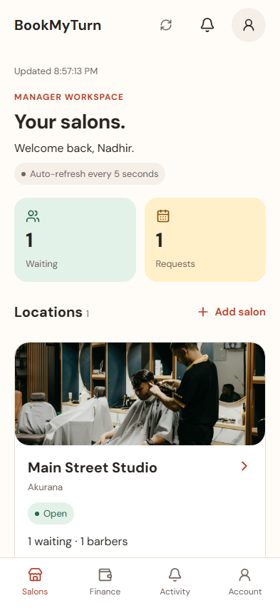 | 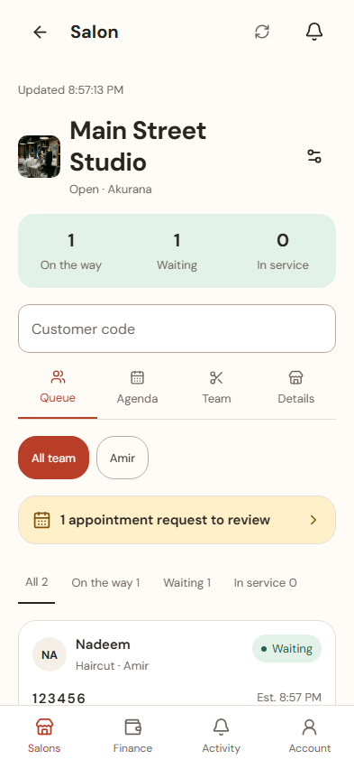 | 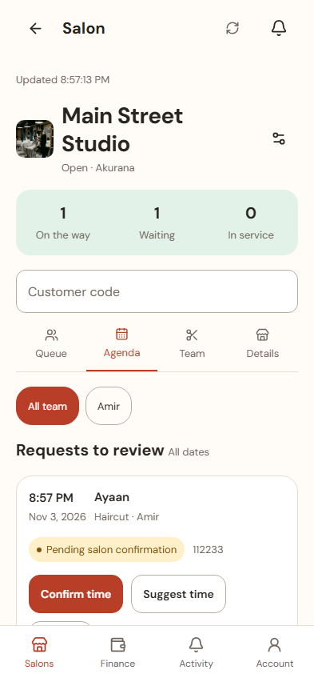 |

| Team | Barber queue | Active haircut |
| --- | --- | --- |
| 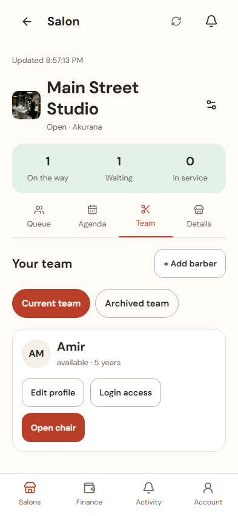 | 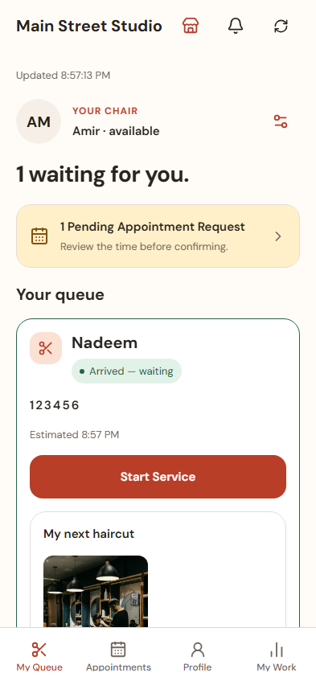 | 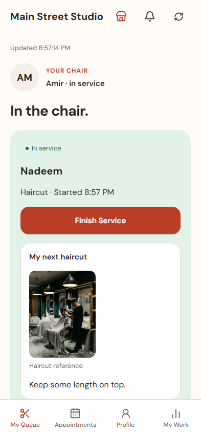 |

| Start | Complete | Next action |
| --- | --- | --- |
| 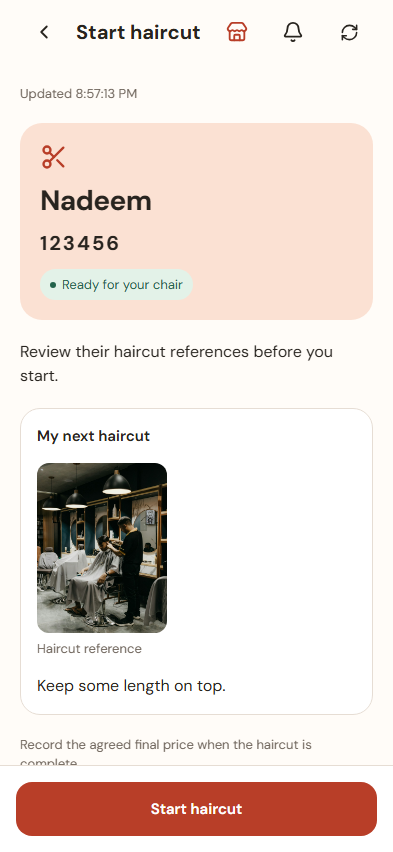 | 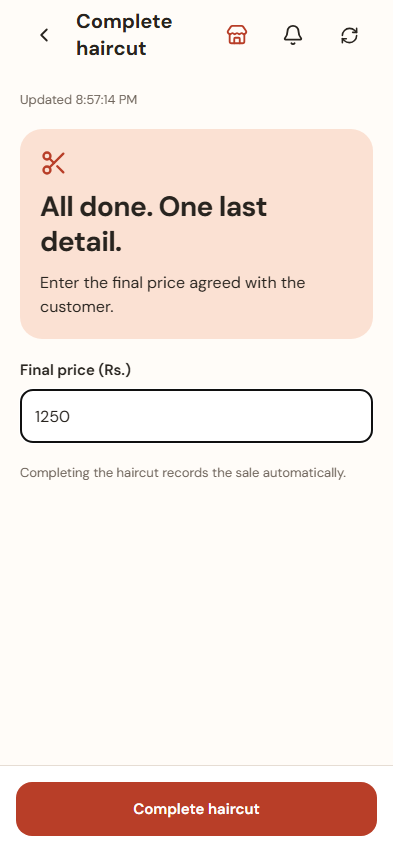 | 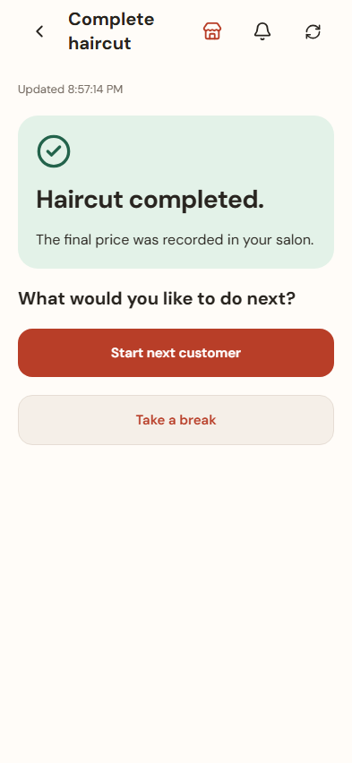 |

| Break | Owner finance | Barber work |
| --- | --- | --- |
| 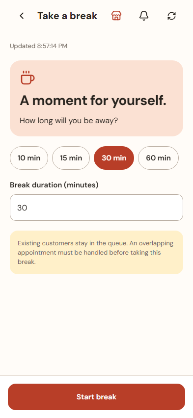 | 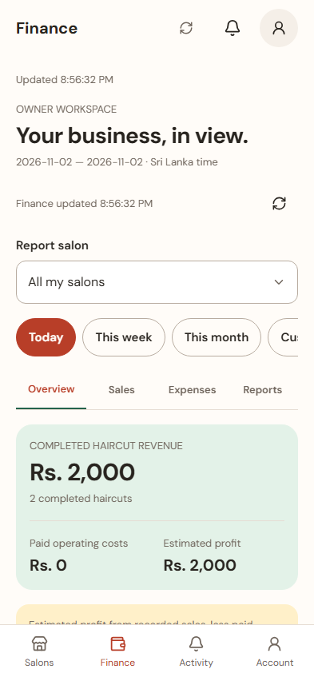 | 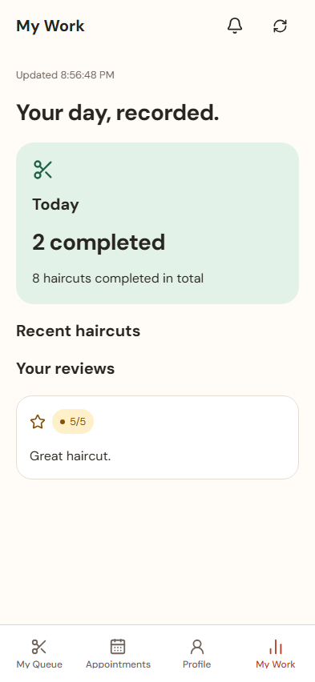 |

[Barber profile](barber-profile.png) · [Invitation controls](barber-invitation.png)

Phone review: create/edit a salon, choose opening times, invite a barber, check in
an existing six-digit code, open a photo reference, start/complete a haircut with
the final price, take a break and confirm an appointment. Repeat with large system
text and the keyboard open. Use a separate invited account to confirm it only
shows permitted operational screens and personal work.
